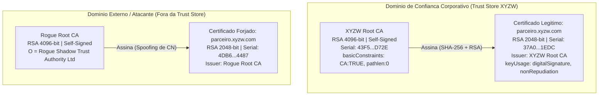

# UNIVERSIDADE FEDERAL DA BAHIA (UFBA)
## INSTITUTO DE COMPUTAÇÃO — DEPARTAMENTO DE CIÊNCIA DA COMPUTAÇÃO

---

<div align="center">

### **RELATÓRIO TÉCNICO DE AUDITORIA E PERÍCIA FORENSE COMPUTACIONAL**
# **TRABALHO 01 — CRIPTOGRAFIA APLICADA: PROTEÇÃO, ASSINATURAS DIGITAIS E CERTIFICADOS**

**Disciplina:** MATC99 — Segurança e Auditoria de Sistemas de Informação  
**Instituição:** Universidade Federal da Bahia (UFBA)  
**Organização Auditada (Cenário):** XYZW Tecnologia e Soluções Digitais S.A.  
**Autor:** Wellington M. J. S. (Engenharia de Segurança da Informação & Perícia Forense)  
**Local e Data:** Salvador — BA, 04 de Novembro de 2026  

</div>

---

## Sumário Executivo

1. [Introdução e Contextualização do Incidente](#1-introdução-e-contextualização-do-incidente)
2. [Fundamentação Teórica](#2-fundamentação-teórica)
3. [Metodologia e Ambiente Experimental](#3-metodologia-e-ambiente-experimental)
4. [Experimentos da Parte I: Proteção e Integridade com AES-256-GCM](#4-experimentos-da-parte-i-proteção-e-integridade-com-aes-256-gcm)
5. [Experimentos da Parte II: Assinaturas Digitais e Cadeia de Certificação](#5-experimentos-da-parte-ii-assinaturas-digitais-e-cadeia-de-certificação)
6. [Matriz de Decisão e Recomendações Corporativas](#6-matriz-de-decisão-e-recomendações-corporativas)
7. [Conclusão](#7-conclusão)
8. [Referências Bibliográficas](#8-referências-bibliográficas)
9. [Anexo: Resposta Sintetizada para o Formulário de Submissão (Google Forms)](#9-anexo-resposta-sintetizada-para-o-formulário-de-submissão-google-forms)

---

## 1. Introdução e Contextualização do Incidente

A **XYZW Tecnologia e Soluções Digitais S.A.** (CNPJ fictício `14.382.910/0001-55`), empresa sediada em Salvador/BA que atua no provimento de infraestrutura crítica para sistemas financeiros, acionou sua equipe de Segurança da Informação e Perícia Forense Computacional após detectar anomalias graves no fluxo de formalização eletrônica do **Contrato Comercial nº 2026/00849-XYZW**, firmado com a fornecedora **Parceiro Infraestrutura e Cloud Computing Ltda.** (`parceiro.xyzw.com`, CNPJ fictício `67.419.002/0001-83`), no valor global de R\$ 1.450.000,00.

A investigação preliminar apontou três vetores críticos de risco operacional e jurídico:

1. **Interceptação e Adulteração em Trânsito (*Man-in-the-Middle* / *Bit-Flipping*):** Contratos trafegando entre matriz e parceiros B2B estavam sujeitos à espionagem industrial (violação de confidencialidade) e à manipulação cirúrgica de bytes em cláusulas financeiras durante a transmissão.
2. **Fraude Documental Pós-Assinatura:** Suspeita de modificação de valores monetários (ex.: alteração de parcelas mensais de R\$ 120.833,33 para R\$ 920.833,33) após a aposição da assinatura digital legítima.
3. **Falsificação Ideológica Criptográfica (*Spoofing* via *Rogue CA*):** Submissão de documentos acompanhados de assinaturas digitais matematicamente íntegras, porém vinculadas a certificados X.509 forjados em nome de `parceiro.xyzw.com` e emitidos por Autoridades Certificadoras não autorizadas (*Rogue CA*).

Para mitigar esses riscos e estabelecer critérios determinísticos de auditoria, este trabalho projeta, executa e valida experimentalmente uma arquitetura de defesa em profundidade estruturada em duas frentes complementares:
- **Frente I (Proteção do Canal e Repouso):** Cifragem simétrica autenticada com dados associados (**AEAD — AES-256-GCM**, conforme NIST SP 800-38D), garantindo confidencialidade e detecção imediata de qualquer alteração de bits no criptograma ou uso de chave incorreta.
- **Frente II (Autenticidade de Origem e Não-Repúdio Jurídico):** Infraestrutura de Chaves Públicas (**PKI / X.509 v3**, conforme RFC 5280) ancorada na autoridade corporativa `XYZW Root CA` (RSA 4096 bits) e assinaturas digitais **RSA-SHA256** (RFC 8017), separando rigorosamente a verificação matemática da assinatura da validação hierárquica da cadeia de confiança.

---

## 2. Fundamentação Teórica

### 2.1. Criptografia Simétrica vs. Criptografia Assimétrica

Os sistemas criptográficos modernos dividem-se fundamentalmente quanto à natureza e gestão de suas chaves:

- **Criptografia Simétrica (Chave Secreta Compartilhada):** Emprega a mesma chave $K$ para as operações de cifragem $C = E_K(P)$ e decifragem $P = D_K(C)$. Caracteriza-se por altíssimo desempenho computacional e baixa latência (frequentemente acelerada em hardware via instruções *AES-NI*), sendo ideal para cifrar grandes volumes de dados em trânsito ou em repouso. Contudo, possui dois limites estruturais: (i) o problema da distribuição escalável de chaves ($O(n^2)$ chaves para $n$ participantes) e (ii) a **ausência de não-repúdio**, pois como ambas as partes detêm $K$, qualquer uma delas poderia ter gerado um criptograma ou tag de autenticação, impedindo a prova pericial perante terceiros de quem originou o documento.
- **Criptografia Assimétrica (Chave Pública):** Baseia-se em funções armadilha unidirecionais (*trapdoor one-way functions*), como a dificuldade da fatoração de grandes inteiros primos no RSA ou o Problema do Logaritmo Discreto em Curvas Elípticas (ECDLP). Cada entidade possui um par matematicamente vinculado $(K_{priv}, K_{pub})$. A chave privada $K_{priv}$ é mantida sob custódia exclusiva do titular, enquanto $K_{pub}$ é distribuída publicamente. Embora seja de 100 a 1.000 vezes mais custosa computacionalmente que cifras simétricas, viabiliza o **não-repúdio** e a **autenticidade de identidade** por meio de assinaturas digitais e certificados X.509.

### 2.2. Funcionamento do Modo AES-GCM (Cifra de Bloco, Counter Mode, GHASH e AEAD)

O **AES-256-GCM** (*Advanced Encryption Standard — Galois/Counter Mode*), especificado pelo **NIST SP 800-38D**, é um esquema **AEAD** (*Authenticated Encryption with Associated Data*) que acopla cifragem em modo contador (**GCTR**) com autenticação polinomial universal (**GHASH**) sobre o corpo finito de Galois $\text{GF}(2^{128})$.

1. **Cifra de Bloco Subjacente (AES-256):** Opera sobre blocos de 128 bits (16 bytes) utilizando uma chave simétrica $K$ de 256 bits (32 bytes) ao longo de 14 rodadas de substituição-permutação (*SubBytes*, *ShiftRows*, *MixColumns* e *AddRoundKey*).
2. **Modo Contador (GCTR) para Confidencialidade:** A partir de um *Nonce* (IV) de 96 bits (12 bytes) gerado por um CSPRNG, constrói-se o bloco pré-contador inicial $J_0 = \text{Nonce}_{96} \parallel 0^{31} \parallel 1$. Para cifrar $n$ blocos de texto em claro $P_1, P_2, \dots, P_n$, o contador é incrementado sequencialmente nos seus 32 bits menos significativos ($\text{inc}_{32}$) e cifrado pelo AES para gerar um *keystream* operado via XOR ($\oplus$) com o texto em claro:
   $$C_i = P_i \oplus E_K(\text{inc}_{32}^i(J_0)), \quad i = 1, 2, \dots, n$$
   Isoladamente, o modo CTR é **maleável**: inverter um bit em $C_i$ inverte exatamente o mesmo bit no plaintext recuperado $P_i$ sem propagação de erro. Por isso, o GCM integra obrigatoriamente a camada GHASH.
3. **Autenticação Universal GHASH em $\text{GF}(2^{128})$ e Integridade AEAD:**
   Deriva-se a subchave secreta de autenticação cifrando um bloco nulo: $H = E_K(0^{128})$. Os Dados Associados não cifrados ($A$, divididos em $m$ blocos de 128 bits) e os blocos de texto cifrado ($C_1, \dots, C_n$), seguidos de um bloco de comprimento $L = [\text{len}(A)_{64} \parallel \text{len}(C)_{64}]$, formam os coeficientes de um polinômio avaliado no ponto secreto $H$ segundo a aritmética do corpo finito $\text{GF}(2^{128})$ definido pelo polinômio irredutível $P(x) = x^{128} + x^7 + x^2 + x + 1$:
   $$\text{GHASH}_H(A, C) = \left( \sum_{i=1}^{m} A_i \cdot H^{m+n+2-i} \right) \oplus \left( \sum_{j=1}^{n} C_j \cdot H^{n+2-j} \right) \oplus (L \cdot H) \pmod{P(x)}$$
   A **Authentication Tag** ($T$, de 128 bits / 16 bytes) é produzida mascarando o resultado do GHASH com o bloco cifrado do contador inicial $J_0$:
   $$T = \text{GHASH}_H(A, C) \oplus E_K(J_0)$$
   Na decifragem (arquitetura *Encrypt-then-MAC*), o destinatário recalcula $T'$ a partir de $(Nonce, A, C)$ recebidos e compara $T' \stackrel{?}{=} T$ em **tempo constante**. Se houver discrepância de sequer 1 bit, a biblioteca lança `InvalidTag` e **descarta imediatamente o buffer**, impedindo qualquer vazamento de texto em claro corrompido.

### 2.3. Infraestrutura de Chaves Públicas (PKI), Cadeia X.509 e Assinaturas RSA

Uma assinatura digital garante integridade, autenticidade e não-repúdio aplicando o esquema *Hash-then-Sign* (**RFC 8017 — PKCS#1**):

1. **Geração da Assinatura:** Dado o documento $M$, calcula-se o resumo criptográfico $h = \text{SHA-256}(M)$ de 256 bits (32 bytes), resistente a colisões e segunda pré-imagem. No padrão **RSASSA-PKCS1-v1_5** (ou de forma probabilística no **RSA-PSS**), o hash $h$ e o OID do algoritmo SHA-256 são encapsulados em uma estrutura ASN.1 `DigestInfo` com preenchimento determinístico ($\text{EM} = \text{0x00} \parallel \text{0x01} \parallel \text{0xFF}\dots\text{0xFF} \parallel \text{0x00} \parallel \text{ASN.1}(h)$) do tamanho do módulo $N$. O titular aplica sua chave privada $d$:
   $$S = \text{EM}^d \bmod N$$
2. **Verificação Matemática da Assinatura:** O verificador aplica a chave pública $(e, N)$ sobre a assinatura $S$ para recuperar o bloco codificado $\text{EM}' = S^e \bmod N$, valida a estrutura de preenchimento PKCS#1 e compara o hash extraído $h'$ com o hash recalculado localmente $\text{SHA-256}(M')$.
3. **O Problema da Autenticidade da Chave Pública e a PKI X.509 (RFC 5280):**
   A verificação matemática $S^e \bmod N$ prova apenas que o documento foi assinado pelo detentor da chave privada correspondente à chave pública apresentada — **mas não prova a quem pertence essa chave pública**. Um atacante pode gerar seu próprio par $(K'_{priv}, K'_{pub})$ e assinar um contrato perfeitamente válido sob $K'_{pub}$.
   Para resolver esse problema, a **PKI X.509** vincula a identidade do titular (`Subject: CN=parceiro.xyzw.com`) à sua chave pública dentro de uma estrutura padronizada (`TBSCertificate`), que é assinada digitalmente por uma **Autoridade Certificadora (CA)** confiável (`Issuer: CN=XYZW Root CA`). A validação da cadeia de certificação percorre a árvore do certificado de entidade final (*Leaf Certificate*) até uma âncora de confiança (*Trust Anchor* / *Root CA*) pré-instalada na *Trust Store* corporativa, verificando:
   - Assinatura criptográfica da CA emissora sobre o certificado filho;
   - Período de validade (`notBefore` e `notAfter`);
   - Restrições de uso de chave e extensões X.509 v3 (`basicConstraints: CA:TRUE/FALSE`, `keyUsage: digitalSignature, nonRepudiation, keyCertSign`, `subjectKeyIdentifier` e `authorityKeyIdentifier`);
   - Estado de não-revogação via listas CRL (*Certificate Revocation List*) ou protocolo OCSP (*Online Certificate Status Protocol*).

---

## 3. Metodologia e Ambiente Experimental

Os experimentos foram conduzidos em ambiente controlado de auditoria sobre subsistema Linux, garantindo total reprodutibilidade científica e conformidade com os padrões de perícia forense (preservação de hashes SHA-256 e logs com carimbo de tempo em milissegundos).

| Componente / Ferramenta | Especificação / Versão Utilizada | Finalidade na Auditoria |
| :--- | :--- | :--- |
| **Sistema Operacional** | Linux Ubuntu 24.04 LTS (Kernel `6.6.87.2-microsoft-standard-WSL2 x86_64`) | Ambiente POSIX isolado para execução de scripts e captura de logs. |
| **Interpretador Python** | `Python 3.12.3` (WSL) / `Python 3.13.14` (Host) | Execução do módulo `parte1_aes_gcm.py` com tipagem estática e logging. |
| **Biblioteca Criptográfica** | `cryptography 41.0.7` / `50.0.2` (`hazmat.primitives.ciphers.aead.AESGCM`) | Implementação validada de AES-256-GCM (backend C/Rust OpenSSL). |
| **Suíte PKI / CLI** | `OpenSSL 3.0.13 30 Jan 2024` | Geração de chaves RSA 4096/2048-bit, emissão X.509 v3, `dgst` e `verify`. |
| **Artefato Contratual** | `contrato_xyzw.txt` (3.621 bytes, UTF-8) | Contrato comercial nº 2026/00849-XYZW (R\$ 1.450.000,00 / 12x R\$ 120.833,33). |

---

## 4. Experimentos da Parte I: Proteção e Integridade com AES-256-GCM

### 4.1. Procedimentos de Cifragem, Empacotamento e Decifragem Legítima

O script [`parte1_aes_gcm.py`](file:///c:/Users/WellingtonMJS/Documents/Trabalho_01_MATC99/parte1_aes_gcm.py) encapsula o ciclo de vida completo do criptograma na classe imutável [`PacoteCriptograficoGCM`](file:///c:/Users/WellingtonMJS/Documents/Trabalho_01_MATC99/parte1_aes_gcm.py#L43-L73):

1. **Inspeção Forense Inicial:** O arquivo [`contrato_xyzw.txt`](file:///c:/Users/WellingtonMJS/Documents/Trabalho_01_MATC99/contrato_xyzw.txt) é lido em modo binário (`3621 bytes`), registrando o hash SHA-256 de referência `6cb64ddc37de25a27c614b37e45de1112a01020e382e5b8e255125d9fb715783`.
2. **Geração de Parâmetros e Cifragem AEAD:**
   - **Chave Simétrica ($K$):** 256 bits (32 bytes) gerada via CSPRNG (`AESGCM.generate_key(bit_length=256)`).
   - **Nonce / IV:** 96 bits (12 bytes) gerados via `os.urandom(12)`.
   - **Dados Associados (AAD):** `b"MATC99-UFBA|XYZW-TECNOLOGIA|CONTRATO-2026-00849|AES-256-GCM"`, autenticados pelo polinômio GHASH para vincular o contexto do contrato ao criptograma.
   - **Empacotamento em Disco (`contrato_xyzw.enc`):** O arquivo binário resultante possui **3.649 bytes**, estruturados sequencialmente como:
     $$\underbrace{\text{Nonce}}_{\text{12 bytes}} \parallel \underbrace{\text{Ciphertext}}_{\text{3621 bytes}} \parallel \underbrace{\text{Authentication Tag}}_{\text{16 bytes}}$$
3. **Decifragem e Verificação de Integridade Byte a Byte:** O arquivo [`contrato_xyzw.enc`](file:///c:/Users/WellingtonMJS/Documents/Trabalho_01_MATC99/contrato_xyzw.enc) é lido do disco, desserializado e submetido a `AESGCM.decrypt()`. A Tag de 128 bits é validada com sucesso e o texto recuperado ([`contrato_xyzw_recuperado.txt`](file:///c:/Users/WellingtonMJS/Documents/Trabalho_01_MATC99/contrato_xyzw_recuperado.txt)) apresenta igualdade estrita de bytes (`plaintext_original == plaintext_recuperado: True`) e idêntico hash SHA-256.

### 4.2. Logs de Execução e Análise Técnica dos Cenários de Falha

Abaixo estão os logs reais extraídos de [`parte1_aes_gcm.log`](file:///c:/Users/WellingtonMJS/Documents/Trabalho_01_MATC99/parte1_aes_gcm.log) durante a execução experimental:

```text
[2026-11-04 14:47:30.608] [INFO    ] INICIANDO AUDITORIA CRIPTOGRÁFICA - PARTE I: AES-256-GCM (AEAD)
[2026-11-04 14:47:30.609] [INFO    ] [PASSO 1] Carregamento e Inspeção Forense do Contrato Original
[2026-11-04 14:47:30.613] [INFO    ] Documento carregado com sucesso: 'contrato_xyzw.txt'
[2026-11-04 14:47:30.613] [INFO    ]   -> Tamanho original (Plaintext): 3621 bytes
[2026-11-04 14:47:30.614] [INFO    ]   -> SHA-256 (Plaintext)         : 6cb64ddc37de25a27c614b37e45de1112a01020e382e5b8e255125d9fb715783
[2026-11-04 14:47:30.614] [INFO    ] [PASSO 2] Cifragem Autenticada AES-256-GCM
[2026-11-04 14:47:30.618] [INFO    ] Cifragem AES-256-GCM concluída e gravada em 'contrato_xyzw.enc'.
[2026-11-04 14:47:30.619] [INFO    ]   -> Chave Simétrica (256 bits)  : 35f0d9e19b1d07290979d3a3817bbfb76fa2c7ce3b0148c01993d7291c82e686
[2026-11-04 14:47:30.619] [INFO    ]   -> Nonce / IV (96 bits / 12B)  : a6af226d6502ae02abf5af0e
[2026-11-04 14:47:30.620] [INFO    ]   -> Dados Associados (AAD)      : MATC99-UFBA|XYZW-TECNOLOGIA|CONTRATO-2026-00849|AES-256-GCM
[2026-11-04 14:47:30.620] [INFO    ]   -> Tamanho do Ciphertext       : 3621 bytes
[2026-11-04 14:47:30.620] [INFO    ]   -> Authentication Tag (128b/16B): e14ca57e1fd1883fac6e6e741d00da60
[2026-11-04 14:47:30.621] [INFO    ]   -> Tamanho Total (.enc)        : 3649 bytes (12B Nonce + 3621B CT + 16B Tag)
[2026-11-04 14:47:30.621] [INFO    ]   -> SHA-256 do Arquivo (.enc)   : 46f61c03d7f959507b168d5db0d88495b63a1741ad2e570fd12527a8f99e3a5a
[2026-11-04 14:47:30.621] [INFO    ] [PASSO 3] Descriptografia Legítima e Conferência de Integridade Byte a Byte
[2026-11-04 14:47:30.626] [INFO    ]   -> Authentication Tag verificada : VÁLIDA (128 bits íntegros)
[2026-11-04 14:47:30.627] [INFO    ]   -> Comparação direta (bytes ==)  : True (3621 == 3621 bytes)
[2026-11-04 14:47:30.627] [INFO    ]   -> [SUCESSO] Integridade e confidencialidade comprovadas sem perda de bits.
[2026-11-04 14:47:30.628] [INFO    ] [CENÁRIO DE FALHA 1] Teste de Adulteração de 1 Byte no Ciphertext (Bit-Flipping)
[2026-11-04 14:47:30.629] [INFO    ]   -> Posição alterada no Ciphertext : Offset 1810 (0x0712)
[2026-11-04 14:47:30.629] [INFO    ]   -> Valor do byte original         : 0x59 (bin: 01011001)
[2026-11-04 14:47:30.629] [INFO    ]   -> Valor após XOR 0x01 (Bit-Flip) : 0x58 (bin: 01011000)
[2026-11-04 14:47:30.636] [WARNING ]   -> [EXCEÇÃO CAPTURADA] Tipo: cryptography.exceptions.InvalidTag | Mensagem: cryptography.exceptions.InvalidTag
[2026-11-04 14:47:30.637] [INFO    ] [CENÁRIO DE FALHA 2] Tentativa de Decifragem com Chave Simétrica Incorreta
[2026-11-04 14:47:30.637] [INFO    ]   -> Chave Legítima (256 bits)      : 35f0d9e19b1d07290979d3a3817bbfb76fa2c7ce3b0148c01993d7291c82e686
[2026-11-04 14:47:30.638] [INFO    ]   -> Chave Espúria  (256 bits)      : 5853588cf0102128f840c16ee6e549b17c450d0823f6c0bb8c62125ddc8b4f82
[2026-11-04 14:47:30.639] [WARNING ]   -> [EXCEÇÃO CAPTURADA] Tipo: cryptography.exceptions.InvalidTag | Mensagem: cryptography.exceptions.InvalidTag
```

#### Análise Matemática da Impossibilidade de Bit-Flipping Silencioso via GHASH

1. **Cenário de Falha 1 (Bit-Flipping de 1 bit no Offset `0x0712`):**
   Na função [`simular_adulteracao_ciphertext`](file:///c:/Users/WellingtonMJS/Documents/Trabalho_01_MATC99/parte1_aes_gcm.py#L168-L216), o byte na posição 1810 do ciphertext (pertencente ao bloco de 128 bits $C_k$, onde $k = \lfloor 1810 / 16 \rfloor + 1 = 114$) teve seu bit menos significativo invertido via operação lógica `XOR 0x01` (`0x59` $\to$ `0x58`), introduzindo um erro algébrico não nulo $\Delta \in \text{GF}(2^{128})$ tal que $C'_k = C_k \oplus \Delta$.
   Ao recalcular a Tag de autenticação $T'$ sobre o texto cifrado modificado $C'$, pela distributividade da multiplicação em $\text{GF}(2^{128})$ sobre a soma (XOR):
   $$\Delta T = T' \oplus T = \text{GHASH}_H(A, C') \oplus \text{GHASH}_H(A, C) = \Delta \cdot H^{n - k + 2} \pmod{P(x)}$$
   Como $P(x) = x^{128} + x^7 + x^2 + x + 1$ é irredutível sobre $\text{GF}(2)$, a estrutura $\text{GF}(2^{128})$ é um **corpo finito** e, portanto, um domínio de integridade **isento de divisores de zero**. Logo, sendo $\Delta \neq 0$ e $H \neq 0$, o termo $\Delta \cdot H^{n-k+2}$ é garantidamente não nulo ($\Delta T \neq 0 \implies T' \neq T$). A verificação falha deterministicamente e dispara `cryptography.exceptions.InvalidTag`.

2. **Cenário de Falha 2 (Chave Simétrica Incorreta $K' \neq K$):**
   Na função [`simular_chave_incorreta`](file:///c:/Users/WellingtonMJS/Documents/Trabalho_01_MATC99/parte1_aes_gcm.py#L219-L253), o uso de uma chave espúria $K'$ altera completamente a permutação pseudoaleatória do AES-256. Consequentemente, tanto a subchave de hash derivada $H' = E_{K'}(0^{128})$ quanto a máscara final $E_{K'}(J_0)$ divergem de $H$ e $E_K(J_0)$. A Tag calculada $T' = \text{GHASH}_{H'}(A, C) \oplus E_{K'}(J_0)$ comporta-se como uma variável uniforme em $\{0,1\}^{128}$, cuja probabilidade de coincidir acidentalmente com $T$ é de $2^{-128} \approx 2,93 \times 10^{-39}$, resultando novamente no disparo imediato de `cryptography.exceptions.InvalidTag`.

### 4.3. Propriedades de Segurança Garantidas na Parte I

- **Confidencialidade (IND-CPA / IND-CCA2):** O fluxo de cifragem em modo contador com Nonce único de 96 bits impede que um adversário passivo extraia qualquer informação semântica sobre as cláusulas ou valores do contrato.
- **Integridade do Criptograma e dos Dados Associados (INT-CTXT):** Qualquer alteração de 1 bit no Nonce, no AAD, no Ciphertext ou na Tag invalida o polinômio GHASH antes que a decifragem seja entregue à aplicação.
- **Autenticidade Simétrica da Origem:** A validação da Tag comprova que o criptograma foi produzido por uma entidade que detinha a chave simétrica $K$ compartilhada. (Nota: não provê não-repúdio perante terceiros, o que motiva os controles da Parte II).

---

## 5. Experimentos da Parte II: Assinaturas Digitais e Cadeia de Certificação

### 5.1. Arquitetura da PKI Simulada (`XYZW Root CA` vs. `Rogue CA`)

O script [`parte2_pki_testes.sh`](file:///c:/Users/WellingtonMJS/Documents/Trabalho_01_MATC99/parte2_pki_testes.sh) provisiona duas hierarquias de certificação X.509 v3 distintas no diretório `pki_xyzw/`:



1. **Autoridade Certificadora Raiz Legítima (`XYZW Root CA`):**
   - **Par de Chaves:** RSA 4096 bits (`xyzw_root_ca.key`).
   - **Distinguished Name (DN):** `C = BR, ST = Bahia, L = Salvador, O = XYZW Tecnologia e Solucoes Digitais S.A., OU = Diretoria de Seguranca da Informacao e PKI Corporativa, CN = XYZW Root CA`.
   - **Extensões X.509 v3:** `basicConstraints = critical, CA:true, pathlen:0` e `keyUsage = critical, digitalSignature, cRLSign, keyCertSign`.
   - **SHA-256 Fingerprint:** `F7:BE:97:49:34:5D:C6:E6:D0:A9:2A:21:94:91:70:F3:4F:9C:CE:9C:12:B3:B0:82:E9:02:6F:B6:E2:7F:4B:88`.
2. **Certificado Legítimo do Parceiro (`parceiro.crt`):**
   - **Par de Chaves:** RSA 2048 bits (`parceiro.key` / `parceiro_pub.pem`).
   - **Subject DN:** `C = BR, ST = Sao Paulo, L = Sao Paulo, O = Parceiro Infraestrutura e Cloud Computing Ltda, OU = Operacoes B2B e Contratos Digitais, CN = parceiro.xyzw.com`.
   - **Issuer DN:** `CN = XYZW Root CA` (Serial `37A01595EEE26CBAF063CB34FC40134687B01EDC`).
   - **Extensões X.509 v3:** `basicConstraints = critical, CA:FALSE`, `keyUsage = critical, digitalSignature, nonRepudiation, keyEncipherment`, `subjectAltName = DNS:parceiro.xyzw.com`.
3. **Infraestrutura Atacante (`Rogue CA` e `parceiro_forjado.crt`):**
   - A `Rogue Root CA` (RSA 4096 bits) emite um certificado X.509 (`parceiro_forjado.crt`, Serial `4DB643DE1A9E12CB773EFAF1352473A982AF4487`) contendo **exatamente o mesmo Subject DN** (`CN = parceiro.xyzw.com`) do parceiro legítimo, porém assinado pela chave privada da `Rogue CA`.

---

### 5.2. Análise Exaustiva do Cenário A (Assinatura Legítima e Cadeia Válida)

#### Comandos Executados
```bash
# 1. Assinatura digital do contrato original com a chave privada legítima (RSA-SHA256)
openssl dgst -sha256 -sign pki_xyzw/parceiro_legitimo/parceiro.key \
    -out pki_xyzw/cenarios_auditoria/cenario_a_contrato.sig \
    pki_xyzw/cenarios_auditoria/contrato_xyzw.txt

# 2. Verificação matemática da assinatura contra a chave pública extraída do certificado legítimo
openssl dgst -sha256 -verify pki_xyzw/parceiro_legitimo/parceiro_pub.pem \
    -signature pki_xyzw/cenarios_auditoria/cenario_a_contrato.sig \
    pki_xyzw/cenarios_auditoria/contrato_xyzw.txt

# 3. Validação da cadeia de certificação X.509 contra a Trust Store corporativa (XYZW Root CA)
openssl verify -CAfile pki_xyzw/root_ca/xyzw_root_ca.crt \
    pki_xyzw/parceiro_legitimo/parceiro.crt
```

#### Logs e Evidências Coletadas (`parte2_pki_testes.log`)
```text
[2026-11-04 14:48:42.189] [INFO] >>> [CENÁRIO A] Contrato Original Assinado pela Chave Privada Legítima de 'parceiro.xyzw.com'
[2026-11-04 14:48:42.223] [INFO]   [A.1] Assinatura digital gerada: cenario_a_contrato.sig (256 bytes)
[2026-11-04 14:48:42.247] [INFO]   [A.2] SHA-256 da assinatura    : 86ac191fbd4721d06be48b0581476b4ab0843f11b2bedde0e5f8fee1e7cb8754
[2026-11-04 14:48:42.257] [INFO]   [A.3] Executando verificação matemática da assinatura (openssl dgst -sha256 -verify):
        Resultado OpenSSL dgst: Verified OK
[2026-11-04 14:48:42.294] [INFO]   [A.4] Executando validação da cadeia X.509 contra a XYZW Root CA (openssl verify):
        Resultado OpenSSL verify: /mnt/c/Users/WellingtonMJS/Documents/Trabalho_01_MATC99/pki_xyzw/parceiro_legitimo/parceiro.crt: OK
```

#### Análise Pericial e Justificativa de Aceitação
- **Integridade e Autenticidade Matemática (`Verified OK`):** A assinatura `cenario_a_contrato.sig` possui 256 bytes (2048 bits, correspondente ao módulo RSA $N$). Ao decifrar a assinatura com a chave pública $(e, N)$ de `parceiro_pub.pem`, o bloco PKCS#1 v1.5 revelou exatamente o digest SHA-256 `6cb64ddc...715783` do arquivo `contrato_xyzw.txt`.
- **Confiabilidade da Identidade (`parceiro.crt: OK`):** O comando `openssl verify` comprovou que a assinatura no certificado `parceiro.crt` foi gerada pela chave privada de `XYZW Root CA`, que o identificador de autoridade (`authorityKeyIdentifier`) corresponde ao `subjectKeyIdentifier` da raiz corporativa e que o certificado está dentro da janela temporal de validade.
- **Veredito de Auditoria:** **ACEITAR**. Estão simultaneamente atendidos os requisitos de integridade documental, autenticidade de origem e não-repúdio jurídico.

---

### 5.3. Análise Exaustiva do Cenário B (Adulteração Pós-Assinatura)

#### Comandos Executados
```bash
# 1. Simulação de fraude contratual: alteração de 1 byte na parcela mensal (R$ 120.833,33 -> R$ 920.833,33)
sed 's/R\$ 120\.833,33/R\$ 920.833,33/g' pki_xyzw/cenarios_auditoria/contrato_xyzw.txt \
    > pki_xyzw/cenarios_auditoria/contrato_xyzw_adulterado.txt

# 2. Verificação da assinatura legítima (Cenário A) contra o documento adulterado
openssl dgst -sha256 -verify pki_xyzw/parceiro_legitimo/parceiro_pub.pem \
    -signature pki_xyzw/cenarios_auditoria/cenario_a_contrato.sig \
    pki_xyzw/cenarios_auditoria/contrato_xyzw_adulterado.txt
```

#### Logs e Evidências Coletadas (`parte2_pki_testes.log`)
```text
[2026-11-04 14:48:42.344] [INFO] >>> [CENÁRIO B] Adulteração Pós-Assinatura no Contrato (Fraude de Valor Monetário)
[2026-11-04 14:48:42.380] [INFO]   [B.1] Adulteração realizada: parcela alterada de 'R$ 120.833,33' para 'R$ 920.833,33' (1 byte modificado)
[2026-11-04 14:48:42.388] [INFO]   [B.2] SHA-256 Documento Original   : 6cb64ddc37de25a27c614b37e45de1112a01020e382e5b8e255125d9fb715783
[2026-11-04 14:48:42.397] [INFO]   [B.3] SHA-256 Documento Adulterado : 23d9b5e5757d846a54b484c9cbcfadac7570d529d3a21089aa809cf9cff6f88d
[2026-11-04 14:48:42.405] [INFO]   [B.4] Executando verificação da assinatura original contra o documento adulterado:
        Código de Retorno (Exit Code): 1
        Resultado OpenSSL dgst       : 408767EB1A790000:error:02000068:rsa routines:ossl_rsa_verify:bad signature:../crypto/rsa/rsa_sign.c:430:
408767EB1A790000:error:1C880004:Provider routines:rsa_verify:RSA lib:../providers/implementations/signature/rsa_sig.c:774:
Verification failure
```

#### Explicação Técnica da Quebra do Hash e Justificativa de Rejeição
- **Efeito Avalanche Estrito do SHA-256:** A substituição do caractere ASCII `'1'` (`0x31`) por `'9'` (`0x39`) altera apenas 1 bit no arquivo de 3.621 bytes (`00110001` $\to$ `00111001`). Devido às rodadas de compressão não-lineares de Davies-Meyer no SHA-256 (funções $\text{Ch}$, $\text{Maj}$, rotações cíclicas $\Sigma_0, \Sigma_1$ e adições módulo $2^{32}$), essa mudança de 1 bit altera aproximadamente 50% dos bits do digest final (`6cb64ddc...` $\to$ `23d9b5e5...`).
- **Divergência no Bloco PKCS#1 (`bad signature` / `Verification failure`):** Quando o OpenSSL executa a exponenciação modular $S^e \bmod N$ usando a chave pública legítima, ele extrai o hash original $h_{\text{orig}} = \text{6cb64ddc...}$ que foi assinado no Cenário A. Ao compará-lo na rotina `ossl_rsa_verify` (`crypto/rsa/rsa_sign.c:430`) com o hash recém-calculado do arquivo fraudado $h_{\text{adult}} = \text{23d9b5e5...}$, a igualdade falha ($h_{\text{orig}} \neq h_{\text{adult}}$) com código de saída `1`.
- **Veredito de Auditoria:** **REJEITAR**. O documento sofreu violação de integridade posterior ao ato de assinatura.

---

### 5.4. Análise Exaustiva do Cenário C (Certificado Forjado pela Rogue CA)

#### Comandos Executados
```bash
# 1. Atacante assina o contrato original com a chave privada do certificado forjado
openssl dgst -sha256 -sign pki_xyzw/parceiro_forjado/parceiro_forjado.key \
    -out pki_xyzw/cenarios_auditoria/cenario_c_contrato_forjado.sig \
    pki_xyzw/cenarios_auditoria/contrato_xyzw.txt

# 2. Verificação matemática isolada contra a chave pública do certificado forjado
openssl dgst -sha256 -verify pki_xyzw/parceiro_forjado/parceiro_forjado_pub.pem \
    -signature pki_xyzw/cenarios_auditoria/cenario_c_contrato_forjado.sig \
    pki_xyzw/cenarios_auditoria/contrato_xyzw.txt

# 3. Validação da cadeia de certificação contra a Trust Store corporativa (XYZW Root CA)
openssl verify -CAfile pki_xyzw/root_ca/xyzw_root_ca.crt \
    pki_xyzw/parceiro_forjado/parceiro_forjado.crt
```

#### Logs e Evidências Coletadas (`parte2_pki_testes.log`)
```text
[2026-11-04 14:48:42.460] [INFO] >>> [CENÁRIO C] Contrato Assinado com Chave Privada Forjada (Emitida pela Rogue CA para 'parceiro.xyzw.com')
[2026-11-04 14:48:42.496] [INFO]   [C.1] Assinatura do atacante gerada: cenario_c_contrato_forjado.sig (256 bytes)
[2026-11-04 14:48:42.502] [INFO]   [C.2] Passo 1 da Auditoria: Verificação matemática contra a chave pública do certificado apresentado pelo atacante:
        Resultado OpenSSL dgst: Verified OK
[2026-11-04 14:48:42.534] [INFO]   [C.3] Passo 2 da Auditoria: Validação do certificado apresentado (parceiro_forjado.crt) contra a Trust Store corporativa (XYZW Root CA):
        Código de Retorno (Exit Code): 2
        C = BR, ST = Sao Paulo, L = Sao Paulo, O = Parceiro Infraestrutura e Cloud Computing Ltda, OU = Operacoes B2B e Contratos Digitais, CN = parceiro.xyzw.com
        error 20 at 0 depth lookup: unable to get local issuer certificate
        error /mnt/c/Users/WellingtonMJS/Documents/Trabalho_01_MATC99/pki_xyzw/parceiro_forjado/parceiro_forjado.crt: verification failed
```

#### Diferenciação entre Integridade Matemática e Autenticidade da Origem (Justificativa de Rejeição)
O Cenário C demonstra a falha mais perigosa em implementações ingênuas de verificação de assinaturas digitais:
1. **Por que `openssl dgst -verify` retornou `Verified OK`?**
   Porque o atacante detém o par de chaves coerente $(K_{\text{priv}}^{\text{rogue}}, K_{\text{pub}}^{\text{rogue}})$. Ele assinou o contrato íntegro com $K_{\text{priv}}^{\text{rogue}}$ e forneceu o certificado forjado contendo $K_{\text{pub}}^{\text{rogue}}$. Matematicamente, $(M^d)^e \equiv M \pmod{N_{\text{rogue}}}$ é verdadeiro. Isso prova apenas que o documento não foi alterado desde que o atacante o assinou (**integridade matemática isolada**).
2. **Por que `openssl verify` falhou com `error 20 at 0 depth lookup: unable to get local issuer certificate`?**
   Durante a construção do caminho de certificação (*Certification Path Building* — RFC 5280, Seção 6), o verificador inspeciona o certificado de nível 0 (`depth 0`, o certificado de entidade final `parceiro_forjado.crt`). Ele lê o campo `Issuer: CN=Rogue Root CA` e o `authorityKeyIdentifier`, buscando na *Trust Store* corporativa (`-CAfile xyzw_root_ca.crt`) o certificado da autoridade emissora capaz de validar a assinatura do certificado folha. Como a `Rogue Root CA` não pertence à *Trust Store* da XYZW Tecnologia, a busca pelo emissor local no nível 0 falha imediatamente com o código `X509_V_ERR_UNABLE_TO_GET_ISSUER_CERT_LOCALLY` (`error 20`) e exit code `2`.
3. **Veredito de Auditoria:** **REJEITAR**. Trata-se de um ataque de falsidade ideológica (*Key Spoofing*): embora o arquivo esteja matematicamente íntegro em relação à chave do atacante, a identidade declarada (`CN=parceiro.xyzw.com`) é ilegítima e não possui cadeia de custódia confiável.

---

## 6. Matriz de Decisão e Recomendações Corporativas

### 6.1. Matriz Comparativa de Auditoria Forense

| Cenário / Experimento | Controle Avaliado | Integridade Matemática do Conteúdo | Autenticidade e Confiabilidade da Identidade / Chave | Evidência Técnica / Código de Retorno | Veredito de Auditoria |
| :--- | :--- | :---: | :---: | :--- | :---: |
| **Parte I — Base Legítima** | Decifragem AES-256-GCM com Chave e Ciphertext íntegros | **VÁLIDA** (`Tag OK`, `SHA-256 ==`) | **VÁLIDA** (Posse da chave simétrica $K$ legítima) | `InvalidTag` não disparada; 3.621 bytes recuperados | **ACEITAR** |
| **Parte I — Falha 1 (Bit-Flipping)** | Adulteração de 1 byte (`XOR 0x01` no Offset `0x0712`) | **INVÁLIDA** ($\Delta T = \Delta \cdot H^{n-k+2} \neq 0$) | **VÁLIDA** (Chave simétrica $K$ correta utilizada) | `cryptography.exceptions.InvalidTag` | **REJEITAR** |
| **Parte I — Falha 2 (Chave Espúria)** | Tentativa de decifragem com chave incorreta $K' \neq K$ | **NÃO VERIFICÁVEL** ($H' \neq H$) | **INVÁLIDA** (Emissor/Receptor sem a chave legítima) | `cryptography.exceptions.InvalidTag` | **REJEITAR** |
| **Parte II — Cenário A** | Contrato íntegro + Chave legítima + Emissor `XYZW Root CA` | **VÁLIDA** (`Verified OK`) | **VÁLIDA** (`parceiro.crt: OK` na *Trust Store*) | Exit Code `0` em `dgst -verify` e `openssl verify` | **ACEITAR** |
| **Parte II — Cenário B** | Contrato adulterado (`R$ 120k` $\to$ `R$ 920k`) pós-assinatura | **INVÁLIDA** (`Verification failure`) | **VÁLIDA** (Certificado legítimo do parceiro) | `ossl_rsa_verify:bad signature` (Exit Code `1`) | **REJEITAR** |
| **Parte II — Cenário C** | Contrato assinado por certificado forjado pela `Rogue CA` | **VÁLIDA** (`Verified OK` contra chave atacante) | **INVÁLIDA** (Fora da *Trust Store* XYZW) | `error 20 at 0 depth lookup: unable to get local issuer certificate` (Exit Code `2`) | **REJEITAR** |

---

### 6.2. Recomendações Técnicas de Governança Criptográfica para a XYZW Tecnologia

Com base nos achados periciais, recomenda-se à Diretoria de Segurança da Informação da XYZW a implementação imediata dos seguintes controles arquiteturais:

1. **Governança Estrita da *Trust Store* Corporativa e Isolamento da Root CA:**
   - A chave privada da `XYZW Root CA` (RSA 4096 bits) deve permanecer **offline (Air-Gapped)** dentro de um **HSM (*Hardware Security Module*) homologado FIPS 140-3 Nível 3**.
   - Criar uma **CA Intermediária Emissora (`XYZW Issuing CA B2B`)** subordinada à Root CA (`pathlen:0` na intermediária) para assinar certificados de parceiros operacionais, evitando a exposição direta da chave raiz.
   - Bloquear via GPO/MDM e *containers* imutáveis a inserção de certificados raiz de terceiros na *Trust Store* dos servidores de validação de contratos, fixando explicitamente o *bundle* `xyzw_root_ca.crt` (*Certificate Pinning* / *Explicit Trust Anchor*).
2. **Verificação Automática de Revogação (CRL e OCSP Stapling):**
   - Implantar pontos de distribuição de Lista de Certificados Revogados (`crlDistributionPoints`) atualizados a cada 24 horas e um respondedor **OCSP (RFC 6960)** de alta disponibilidade.
   - O pipeline de aceitação de contratos deve executar `openssl verify -crl_check_all` (ou consulta OCSP obrigatória em modo *hard-fail*) antes de validar qualquer assinatura digital, neutralizando certificados legítimos cujas chaves privadas tenham sido comprometidas.
3. **Políticas Estritas de Extensões X.509 v3 e Restrição de Nome (`nameConstraints`):**
   - Exigir que os certificados emitidos para assinatura de contratos possuam os bits `keyUsage = critical, digitalSignature, nonRepudiation` (`contentCommitment`) e `basicConstraints = critical, CA:FALSE`. O sistema de validação da XYZW deve rejeitar assinaturas de documentos feitas com certificados destinados apenas a TLS (`keyEncipherment` isolado) ou sem a flag `CA:FALSE`.
   - Aplicar a extensão crítica `nameConstraints = permitted;DNS:.xyzw.com` nas CAs intermediárias para impedir matematicamente a emissão de certificados para domínios fora do escopo autorizado.
4. **Gestão Segura de Chaves Simétricas e Nonces no AES-256-GCM:**
   - Estabelecer rotação automática de chaves de dados (*Data Encryption Keys — DEK*) utilizando *Envelope Encryption* gerenciado por KMS/HSM (*Key Encryption Keys — KEK*), garantindo que uma mesma chave AES-256-GCM jamais ultrapasse o limite de $2^{32}$ invocações com Nonces aleatórios de 96 bits (conforme seção 8.3 do NIST SP 800-38D), prevenindo colisões de contador ($J_0$) que comprometeriam a confidencialidade do CTR e vazarariam a subchave $H$ do GHASH.
   - Migrar gradualmente o esquema de preenchimento de assinaturas RSA de **PKCS#1 v1.5** para **RSASSA-PSS** (probabilístico, RFC 8017 Seção 8.1) acompanhado de carimbo do tempo criptográfico (**RFC 3161 — Time-Stamp Protocol / TSA**) para comprovar a existência temporal da assinatura antes da expiração ou revogação do certificado.

---

## 7. Conclusão

A intervenção experimental conduzida para a **XYZW Tecnologia** comprovou de maneira cabal que a segurança de transações contratuais digitais exige a articulação sinérgica entre **cifragem autenticada (AEAD)** e **Infraestrutura de Chaves Públicas (PKI)**.

Na **Parte I**, demonstrou-se que o modo **AES-256-GCM** supera a vulnerabilidade de maleabilidade dos modos de cifragem clássicos ao acoplar o polinômio algébrico **GHASH** em $\text{GF}(2^{128})$ ao modo contador. Os testes experimentais comprovaram que a inversão de um único bit no meio de um criptograma de 3.649 bytes (`Offset 0x0712`) ou a utilização de uma chave espúria de 256 bits são instantaneamente bloqueadas pelo disparo da exceção `cryptography.exceptions.InvalidTag`, impedindo que dados corrompidos ou forjados cheguem à camada de negócios.

Na **Parte II**, os experimentos com **OpenSSL 3.0.13** evidenciaram a distinção fundamental entre **validade matemática de uma assinatura** e **legitimidade da identidade do signatário**. Enquanto o **Cenário B** demonstrou como o efeito avalanche do **SHA-256** neutraliza fraudes de valores pós-assinatura (`Verification failure`), o **Cenário C** expôs o risco crítico de sistemas que validam apenas a operação matemática RSA (`Verified OK`) sem confrontar a cadeia X.509 contra uma *Trust Store* governada (`error 20 at 0 depth lookup: unable to get local issuer certificate`). A adoção obrigatória do fluxo de verificação em duas etapas — validação da cadeia X.509 até a `XYZW Root CA` seguida da verificação criptográfica RSA-SHA256 — restabelece integralmente as propriedades de confidencialidade, integridade, autenticidade e não-repúdio nos processos da organização.

---

## 8. Referências Bibliográficas

1. **DWORKIN, Morris J.** *Recommendation for Block Cipher Modes of Operation: Galois/Counter Mode (GCM) and GMAC*. **NIST Special Publication (SP) 800-38D**, National Institute of Standards and Technology, Gaithersburg, MD, Nov. 2007. DOI: `10.6028/NIST.SP.800-38D`.
2. **COOPER, D.; SANTESSON, S.; FARRELL, S.; BOEYEN, S.; HOUSLEY, R.; POLK, W.** *Internet X.509 Public Key Infrastructure Certificate and Certificate Revocation List (CRL) Profile*. **IETF RFC 5280**, Internet Engineering Task Force, Maio 2008. Disponível em: `https://datatracker.ietf.org/doc/html/rfc5280`.
3. **MORIARTY, K.; KALISKI, B.; JONSSON, J.; RUSCH, A.** *PKCS #1: RSA Cryptography Specifications Version 2.2*. **IETF RFC 8017**, Internet Engineering Task Force, Nov. 2016. Disponível em: `https://datatracker.ietf.org/doc/html/rfc8017`.
4. **NATIONAL INSTITUTE OF STANDARDS AND TECHNOLOGY (NIST).** *Advanced Encryption Standard (AES)*. **FIPS PUB 197**, U.S. Department of Commerce, Atualização 2023.
5. **NATIONAL INSTITUTE OF STANDARDS AND TECHNOLOGY (NIST).** *Secure Hash Standard (SHS)*. **FIPS PUB 180-4**, U.S. Department of Commerce, Ago. 2015.
6. **STALLINGS, William.** *Criptografia e Segurança de Redes: Princípios e Práticas*. 8ª Edição. São Paulo: Pearson Education, 2023.

---

## 9. Anexo: Resposta Sintetizada para o Formulário de Submissão (Google Forms)

> **Instrução:** Copie e cole o texto abaixo diretamente no campo obrigatório **"3. Ferramentas utilizadas"** do formulário de entrega da disciplina MATC99.

**Texto para o campo "3. Ferramentas utilizadas":**

```text
Para a implementação, execução experimental e coleta de evidências forenses do Trabalho 01 (MATC99 - UFBA), foram utilizadas as seguintes ferramentas, bibliotecas e versões em ambiente Linux (Ubuntu 24.04 LTS / Kernel 6.6.87.2-microsoft-standard-WSL2 x86_64):

1. Parte I (Cifragem Simétrica Autenticada AEAD - AES-256-GCM):
   - Linguagem: Python 3.12.3 (compatível e validado também em Python 3.13.14).
   - Biblioteca Criptográfica: Python `cryptography` v41.0.7 / v50.0.2 (módulo `cryptography.hazmat.primitives.ciphers.aead.AESGCM` para cifragem/decifragem AES-256-GCM com Nonce de 96 bits e Tag GHASH de 128 bits, e `cryptography.exceptions.InvalidTag` para captura e tratamento das falhas de integridade por bit-flipping e chave espúria).
   - Módulos Nativos Python: `os.urandom` (geração CSPRNG de Nonce e chaves), `hashlib` (auditoria de integridade SHA-256), `logging` e `traceback` (geração de logs forenses com timestamps ISO-8601).

2. Parte II (Infraestrutura de Chaves Públicas X.509 e Assinaturas Digitais RSA-SHA256):
   - Ferramenta CLI Criptográfica: OpenSSL 3.0.13 (30 Jan 2024), utilizando os subcomandos:
     * `openssl genrsa`: geração de pares de chaves assimétricas RSA de 4096 bits (Root CA legítima e Rogue CA) e 2048 bits (entidades finais).
     * `openssl req` e `openssl x509`: geração de CSRs e emissão de certificados digitais X.509 v3 com extensões `basicConstraints`, `keyUsage`, `extendedKeyUsage` e `subjectAltName`.
     * `openssl dgst -sha256 -sign` e `openssl dgst -sha256 -verify`: assinatura digital RSA-SHA256 e verificação matemática de integridade documental.
     * `openssl verify -CAfile`: validação hierárquica da cadeia de certificação contra a Trust Store corporativa (`XYZW Root CA`).
   - Automação e Utilitários POSIX: GNU Bash 5.2, GNU coreutils (`sha256sum`, `wc`, `chmod`) e `sed` (simulação de adulteração pós-assinatura no Cenário B).
```

