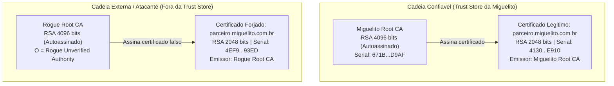

# UNIVERSIDADE FEDERAL DA BAHIA (UFBA)
## INSTITUTO DE COMPUTAÇÃO — DEPARTAMENTO DE CIÊNCIA DA COMPUTAÇÃO

---

<div align="center">

### **RELATÓRIO TÉCNICO**
# **TRABALHO 01 — CRIPTOGRAFIA APLICADA: PROTEÇÃO, ASSINATURAS DIGITAIS E CERTIFICADOS**

**Disciplina:** MATC99 — Segurança e Auditoria de Sistemas de Informação  
**Instituição:** Universidade Federal da Bahia (UFBA)  
**Empresa Auditada (Cenário):** Miguelito Segurança e Tecnologia Ltda.  
**Autor:** Wellington Miguel de Jesus Silva  
**Local e Data:** Salvador — BA, 06 de Novembro de 2026  

</div>

---

## Sumário

1. [Introdução e Contextualização do Incidente](#1-introdução-e-contextualização-do-incidente)
2. [Fundamentação Teórica](#2-fundamentação-teórica)
3. [Metodologia e Ambiente Experimental](#3-metodologia-e-ambiente-experimental)
4. [Experimentos da Parte I: Proteção e Integridade com AES-256-GCM](#4-experimentos-da-parte-i-proteção-e-integridade-com-aes-256-gcm)
5. [Experimentos da Parte II: Assinaturas Digitais e Cadeia de Certificação](#5-experimentos-da-parte-ii-assinaturas-digitais-e-cadeia-de-certificação)
6. [Matriz de Decisão e Recomendações Corporativas](#6-matriz-de-decisão-e-recomendações-corporativas)
7. [Conclusão](#7-conclusão)
8. [Referências Bibliográficas](#8-referências-bibliográficas)

---

## 1. Introdução e Contextualização do Incidente

A empresa fictícia **Miguelito Segurança e Tecnologia Ltda.** (CNPJ `14.382.910/0001-55`), localizada em Salvador/BA, realiza a contratação de infraestrutura em nuvem híbrida e links dedicados junto a fornecedores externos por meio de contratos eletrônicos. Durante uma revisão interna sobre a tramitação do **Contrato Comercial nº 2026/00849-MST**, firmado com a fornecedora **Parceiro Infraestrutura e Cloud Computing Ltda.** (`parceiro.miguelito.com.br`, CNPJ `67.419.002/0001-83`) no valor total de R\$ 1.450.000,00, a equipe de auditoria levantou suspeitas de duas falhas graves no fluxo documental: a possibilidade de alteração de valores financeiros durante o trânsito dos arquivos e a apresentação de certificados digitais emitidos por autoridades desconhecidas.

Na prática, um contrato eletrônico desprotegido ou validado de forma superficial abre margem para três problemas distintos:

1. **Vazamento e manipulação em trânsito (*Bit-Flipping*):** Sem cifragem autenticada, um intermediário na rede pode tanto ler cláusulas confidenciais quanto modificar bytes específicos do arquivo cifrado caso o modo de operação seja maleável.
2. **Adulteração pós-assinatura:** Mesmo que um documento tenha sido assinado por um parceiro real, alterações posteriores no texto (como mudar o valor de uma parcela mensal de R\$ 120.833,33 para R\$ 920.833,33) precisam invalidar a assinatura imediatamente no momento da conferência.
3. **Uso de certificados falsos (*Spoofing* com *Rogue CA*):** Um invasor pode gerar seu próprio par de chaves RSA, criar uma Autoridade Certificadora própria (*Rogue CA*), emitir um certificado com o mesmo nome comum (`CN = parceiro.miguelito.com.br`) e assinar o documento. Se o sistema da empresa conferir apenas se a assinatura bate matematicamente com a chave pública anexada, sem verificar quem emitiu aquele certificado, a fraude passa despercebida.

O objetivo deste trabalho é implementar e validar em laboratório os mecanismos criptográficos necessários para fechar essas brechas na Miguelito Segurança e Tecnologia, dividindo os experimentos em duas partes: proteção simétrica autenticada via **AES-256-GCM** (Parte I) e validação de assinaturas digitais e cadeia de certificação **PKI / X.509** com OpenSSL (Parte II).

---

## 2. Fundamentação Teórica

### 2.1. Criptografia Simétrica vs. Criptografia Assimétrica

A principal diferença entre os dois modelos está na relação entre as chaves de quem protege e de quem verifica a informação:

- **Criptografia Simétrica:** Emprega uma única chave secreta compartilhada $K$ tanto para cifrar ($C = E_K(P)$) quanto para decifrar ($P = D_K(C)$). Por basear-se em operações de substituição, permutação e aritmética binária rápida (com suporte direto em hardware nos processadores atuais via instruções *AES-NI*), é a escolha padrão para proteger arquivos grandes e tráfego de rede em tempo real. Por outro lado, exige um canal seguro prévio para combinar a chave entre as partes e **não oferece não-repúdio** perante um juiz ou auditor externo: como os dois lados possuem a mesma chave $K$, qualquer um dos dois poderia ter gerado um determinado criptograma.
- **Criptografia Assimétrica (Chave Pública):** Utiliza um par de chaves matematicamente ligadas $(K_{priv}, K_{pub})$, construídas sobre problemas difíceis de inverter sem a informação secreta (como a fatoração do produto de dois primos grandes no caso do RSA). A chave privada $K_{priv}$ fica apenas com o dono, enquanto a chave pública $K_{pub}$ pode ser distribuída abertamente. Ela é bem mais lenta que a simétrica para cifrar grandes volumes de dados, mas resolve o problema de distribuição de chaves e permite criar **assinaturas digitais**, garantindo autenticidade de origem e não-repúdio.

### 2.2. Funcionamento do Modo AES-GCM (Cifra de Bloco, Counter Mode, GHASH e AEAD)

O **AES-GCM** (*Galois/Counter Mode*), padronizado pelo **NIST SP 800-38D**, é um modo de operação **AEAD** (*Authenticated Encryption with Associated Data*). Ele resolve um problema clássico de segurança: modos que apenas cifram os dados (como CBC ou CTR puros) garantem confidencialidade, mas não impedem que um atacante altere bits do texto cifrado no caminho. O GCM combina o modo contador para cifrar com a função **GHASH** para autenticar:

1. **Cifra de Bloco (AES-256) e Counter Mode (GCTR):** O AES-256 trabalha com blocos de 128 bits (16 bytes) e chave $K$ de 256 bits (32 bytes). A partir de um *Nonce* (IV) de 96 bits (12 bytes), monta-se o contador inicial $J_0 = \text{Nonce}_{96} \parallel 0^{31} \parallel 1$. A cada bloco de texto em claro $P_i$, o contador é incrementado ($\text{inc}_{32}$), cifrado pelo AES com a chave $K$ e combinado via XOR ($\oplus$) com o texto original:
   $$C_i = P_i \oplus E_K(\text{inc}_{32}^i(J_0)), \quad i = 1, \dots, n$$
   Note que, se olharmos apenas para essa equação, inverter um bit em $C_i$ inverte exatamente o mesmo bit em $P_i$ na hora de decifrar. É justamente para travar essa maleabilidade que entra o GHASH.
2. **Autenticação Universal via GHASH em $\text{GF}(2^{128})$:**
   Primeiro, deriva-se uma subchave de autenticação cifrando um bloco de 128 bits zerado: $H = E_K(0^{128})$. Em seguida, os Dados Associados não cifrados ($A$, com $m$ blocos) e os blocos já cifrados ($C_1, \dots, C_n$), junto com um bloco final $L$ que guarda os tamanhos em bits de $A$ e $C$, entram como coeficientes de um polinômio avaliado em $H$ no corpo finito $\text{GF}(2^{128})$, definido pelo polinômio irredutível $P(x) = x^{128} + x^7 + x^2 + x + 1$:
   $$\text{GHASH}_H(A, C) = \left( \sum_{i=1}^{m} A_i \cdot H^{m+n+2-i} \right) \oplus \left( \sum_{j=1}^{n} C_j \cdot H^{n+2-j} \right) \oplus (L \cdot H) \pmod{P(x)}$$
   O resultado desse polinômio sofre um XOR com a cifragem do contador inicial $J_0$, gerando a **Authentication Tag** $T$ de 128 bits (16 bytes):
   $$T = \text{GHASH}_H(A, C) \oplus E_K(J_0)$$
   Quando o destinatário vai decifrar o arquivo, ele recalcula $T'$ sobre o texto cifrado recebido **antes** de devolver o texto em claro (esquema *Encrypt-then-MAC*). Se $T' \neq T$, a biblioteca interrompe o processo e lança a exceção `InvalidTag`.

### 2.3. Infraestrutura de Chaves Públicas (PKI), Cadeia X.509 e Assinaturas RSA

Na assinatura digital com **RSA e SHA-256** (padronizada na **RFC 8017 — PKCS#1**), o documento inteiro não é elevado diretamente à chave privada devido ao limite de tamanho do módulo RSA e por questões de segurança. O processo ocorre em duas etapas (*Hash-then-Sign*):

1. **Cálculo do Hash e Assinatura:** Calcula-se o resumo criptográfico $h = \text{SHA-256}(M)$ sobre o documento original. No esquema **PKCS#1 v1.5** (padrão utilizado pelo comando `openssl dgst -sha256 -sign`), o hash $h$ e o identificador do algoritmo SHA-256 são empacotados em uma estrutura ASN.1 (`DigestInfo`) e preenchidos até o tamanho da chave (256 bytes para RSA 2048 bits), formando o bloco $\text{EM}$. O signatário aplica sua chave privada $(d, N)$:
   $$S = \text{EM}^d \bmod N$$
   *(Observação: a RFC 8017 também define o esquema probabilístico **RSA-PSS**, que adiciona um salt aleatório ao preenchimento para reforçar a prova matemática de segurança).*
2. **Verificação Matemática:** Quem recebe o documento calcula o hash local $\text{SHA-256}(M')$ e usa a chave pública $(e, N)$ sobre a assinatura ($S^e \bmod N$) para abrir o bloco $\text{EM}$ e comparar se os dois hashes são idênticos.
3. **O Papel da PKI e da Cadeia X.509 (RFC 5280):**
   Saber que uma assinatura fecha matematicamente com uma chave pública não responde à pergunta principal de uma auditoria: *"Essa chave pública realmente pertence à empresa parceira ou foi gerada por um atacante?"*.
   A **PKI (Infraestrutura de Chaves Públicas)** resolve isso através dos certificados digitais **X.509**. Uma **Autoridade Certificadora Raiz (Root CA)** — no nosso caso, a `Miguelito Root CA` — verifica a identidade do parceiro e assina digitalmente um certificado (`parceiro.crt`) que amarra o nome do titular (`Subject: CN=parceiro.miguelito.com.br`) à sua chave pública. Na hora de auditar um contrato, o sistema precisa realizar duas checagens obrigatórias:
   - Conferir a assinatura do arquivo usando a chave pública do certificado;
   - Conferir se o certificado do signatário foi emitido por uma CA presente na **Trust Store** da empresa (`miguelito_root_ca.crt`), respeitando validade temporal e extensões de uso de chave (`basicConstraints` e `keyUsage`).

---

## 3. Metodologia e Ambiente Experimental

Os scripts e testes foram executados em ambiente Linux sob o WSL2, mantendo o registro de todos os comandos, tamanhos de arquivos e hashes SHA-256 nos arquivos de log.

| Componente | Versão / Especificação | Uso no Trabalho |
| :--- | :--- | :--- |
| **Sistema Operacional** | Ubuntu 24.04 LTS (Linux Kernel `6.6.87.2-microsoft-standard-WSL2 x86_64`) | Execução dos scripts Python e Bash. |
| **Python** | `Python 3.12.3` (WSL) / `Python 3.13.14` | Execução do script `parte1_aes_gcm.py`. |
| **Biblioteca `cryptography`** | `v41.0.7` / `v50.0.2` (`AESGCM` e `InvalidTag`) | Cifragem autenticada AES-256-GCM e tratamento de exceções. |
| **OpenSSL** | `OpenSSL 3.0.13 (30 Jan 2024)` | Criação das CAs, emissão de certificados X.509 v3, assinatura e verificação. |
| **Documento de Teste** | `contrato_miguelito.txt` (2.841 bytes, UTF-8) | Contrato comercial nº 2026/00849-MST da Miguelito Segurança e Tecnologia. |

---

## 4. Experimentos da Parte I: Proteção e Integridade com AES-256-GCM

### 4.1. Cifragem e Decifragem do Contrato

O script [`parte1_aes_gcm.py`](file:///c:/Users/WellingtonMJS/Documents/Trabalho_01_MATC99/parte1_aes_gcm.py) organiza os dados do criptograma na classe [`CriptogramaGCM`](file:///c:/Users/WellingtonMJS/Documents/Trabalho_01_MATC99/parte1_aes_gcm.py#L38-L65) e executa o fluxo em três passos iniciais:

1. **Leitura do contrato original:** O arquivo [`contrato_miguelito.txt`](file:///c:/Users/WellingtonMJS/Documents/Trabalho_01_MATC99/contrato_miguelito.txt) (2.841 bytes) é carregado e seu hash SHA-256 é calculado (`9147c03987856361e26a46f794f9588fe0850329cc2eaa28d5f0fd6ffe0cfe67`).
2. **Cifragem AES-256-GCM:** Gera-se uma chave aleatória de 256 bits (32 bytes) com `AESGCM.generate_key(256)` e um Nonce de 96 bits (12 bytes) com `os.urandom(12)`. Como dados associados (AAD), passamos a string `MATC99-UFBA|MIGUELITO-SEGURANCA-E-TECNOLOGIA|CONTRATO-2026-00849`. O arquivo salvo em [`contrato_miguelito.enc`](file:///c:/Users/WellingtonMJS/Documents/Trabalho_01_MATC99/contrato_miguelito.enc) fica com **2.869 bytes**, sendo:
   - `12 bytes` do Nonce no início;
   - `2.841 bytes` do texto cifrado (*ciphertext*);
   - `16 bytes` da *Authentication Tag* no final.
3. **Recuperação e conferência:** O script lê os bytes de `contrato_miguelito.enc`, separa o Nonce do restante e chama [`decifrar_contrato`](file:///c:/Users/WellingtonMJS/Documents/Trabalho_01_MATC99/parte1_aes_gcm.py#L123-L138). O arquivo decifrado ([`contrato_miguelito_recuperado.txt`](file:///c:/Users/WellingtonMJS/Documents/Trabalho_01_MATC99/contrato_miguelito_recuperado.txt)) bate byte a byte com o original (`True`, 2.841 bytes) e mantém exatamente o mesmo hash SHA-256.

### 4.2. Logs de Execução e Análise das Falhas

Abaixo está o log gerado em [`parte1_aes_gcm.log`](file:///c:/Users/WellingtonMJS/Documents/Trabalho_01_MATC99/parte1_aes_gcm.log):

```text
[2026-11-04 15:36:36.889] [INFO] === Auditoria Criptográfica - Miguelito Segurança e Tecnologia (Parte I: AES-256-GCM) ===
[2026-11-04 15:36:36.890] [INFO] [Passo 1] Carregando o contrato original...
[2026-11-04 15:36:36.894] [INFO] Contrato carregado: contrato_miguelito.txt (2841 bytes)
[2026-11-04 15:36:36.895] [INFO] SHA-256 original: 9147c03987856361e26a46f794f9588fe0850329cc2eaa28d5f0fd6ffe0cfe67
[2026-11-04 15:36:36.895] [INFO] [Passo 2] Cifrando o documento com AES-256-GCM...
[2026-11-04 15:36:36.901] [INFO] Arquivo cifrado salvo em: contrato_miguelito.enc (2869 bytes totais)
[2026-11-04 15:36:36.901] [INFO]   Chave AES-256 (32B) : 185c3c58dc5153a9b84ddaf0b85ec9933e52f67c44f8d150f42151a460aa8a28
[2026-11-04 15:36:36.902] [INFO]   Nonce / IV (12B)    : 1d5d2cb6580417d1f29dbf07
[2026-11-04 15:36:36.902] [INFO]   AAD                 : MATC99-UFBA|MIGUELITO-SEGURANCA-E-TECNOLOGIA|CONTRATO-2026-00849
[2026-11-04 15:36:36.903] [INFO]   Ciphertext          : 2841 bytes
[2026-11-04 15:36:36.903] [INFO]   Auth Tag (16B)      : f987ee9b9f25a4ea8cbcac904a675b94
[2026-11-04 15:36:36.903] [INFO]   SHA-256 (.enc)      : 411df1f9eb37861b0697853141b4c19045aad70a554567a4164354135ab85d8c
[2026-11-04 15:36:36.904] [INFO] [Passo 3] Lendo o arquivo .enc e validando a recuperação do documento...
[2026-11-04 15:36:36.909] [INFO] Comparação de bytes (original == recuperado): True (2841 bytes)
[2026-11-04 15:36:36.909] [INFO] SHA-256 recuperado: 9147c03987856361e26a46f794f9588fe0850329cc2eaa28d5f0fd6ffe0cfe67
[2026-11-04 15:36:36.910] [INFO] --- [Teste de Falha 1: Adulteração de 1 byte no Ciphertext (Bit-Flipping)] ---
[2026-11-04 15:36:36.910] [INFO] Byte modificado no offset 1420 (0x058C): 0x4B -> 0x4A
[2026-11-04 15:36:36.910] [WARNING] Exceção capturada com sucesso: cryptography.exceptions.InvalidTag
[2026-11-04 15:36:36.911] [INFO] Motivo: A alteração no bloco cifrado mudou o resultado do polinômio GHASH em GF(2^128). Como a tag recalculada divergiu da tag original, a decifragem foi abortada.
[2026-11-04 15:36:36.911] [INFO] --- [Teste de Falha 2: Tentativa de Decifragem com Chave Incorreta] ---
[2026-11-04 15:36:36.911] [INFO] Chave correta : 185c3c58dc5153a9b84ddaf0b85ec9933e52f67c44f8d150f42151a460aa8a28
[2026-11-04 15:36:36.912] [INFO] Chave errada  : 8908f8e494c7d2089963f9ca67836a1d43bfc0a0ea511d3343b5c0a40d8df58e
[2026-11-04 15:36:36.912] [WARNING] Exceção capturada com sucesso: cryptography.exceptions.InvalidTag
[2026-11-04 15:36:36.913] [INFO] Motivo: Com uma chave K' diferente, tanto a subchave do GHASH H' = E_K'(0^128) quanto o bloco cifrado do contador inicial E_K'(J0) mudam completamente, invalidando a tag.
```

#### Explicação Matemática do Bloqueio pelo GHASH

1. **Adulteração de 1 byte no Ciphertext (Offset `1420` / `0x058C`):**
   Na função [`teste_adulteracao_ciphertext`](file:///c:/Users/WellingtonMJS/Documents/Trabalho_01_MATC99/parte1_aes_gcm.py#L141-L179), aplicamos `XOR 0x01` no byte da posição 1420 do texto cifrado (`0x72` virou `0x73`). Esse byte faz parte de um bloco de 128 bits $C_k$ (com $k = \lfloor 1420/16 \rfloor + 1 = 89$), que passou a valer $C'_k = C_k \oplus \Delta$, onde $\Delta \neq 0$.
   Quando o receptor recalcula a Tag $T'$ sobre o texto cifrado adulterado, a diferença algébrica entre a tag nova e a original dentro de $\text{GF}(2^{128})$ é dada por:
   $$\Delta T = T' \oplus T = \Delta \cdot H^{n - k + 2} \pmod{P(x)}$$
   Como $\text{GF}(2^{128})$ é um corpo finito, ele **não possui divisores de zero**. Isso significa que, para qualquer alteração $\Delta \neq 0$ e uma subchave $H \neq 0$, o produto $\Delta \cdot H^{n-k+2}$ nunca resulta em zero. Consequentemente, $T' \neq T$ e a biblioteca dispara `cryptography.exceptions.InvalidTag` sem retornar nenhum byte do texto decifrado.
2. **Uso de Chave Simétrica Incorreta:**
   Na função [`teste_chave_incorreta`](file:///c:/Users/WellingtonMJS/Documents/Trabalho_01_MATC99/parte1_aes_gcm.py#L182-L210), tentamos abrir o pacote usando outra chave de 256 bits ($K'$). Como a subchave do GHASH depende da chave do AES ($H' = E_{K'}(0^{128})$) e a máscara final também ($E_{K'}(J_0)$), a tag calculada na verificação sai completamente diferente da tag gravada no arquivo (a chance de colisão aleatória em 128 bits é de $2^{-128} \approx 2,93 \times 10^{-39}$), lançando novamente `InvalidTag`.

### 4.3. Propriedades de Segurança Garantidas

Com o AES-256-GCM configurado dessa forma, a Miguelito Segurança e Tecnologia garante:
- **Confidencialidade:** O contrato viaja cifrado pelo fluxo de blocos do modo CTR com chave de 256 bits.
- **Integridade e Autenticidade do Cifrado:** Qualquer modificação em trânsito no texto cifrado, no Nonce ou nos metadados (AAD) é barrada na verificação da Tag de 128 bits antes mesmo de a aplicação processar o texto.

---

## 5. Experimentos da Parte II: Assinaturas Digitais e Cadeia de Certificação

### 5.1. Estrutura da PKI Simulada (`Miguelito Root CA` vs. `Rogue CA`)

O script [`parte2_pki_testes.sh`](file:///c:/Users/WellingtonMJS/Documents/Trabalho_01_MATC99/parte2_pki_testes.sh) monta duas cadeias de certificação separadas dentro de `pki_miguelito/`:



- **`Miguelito Root CA` (`miguelito_root_ca.crt`):** Par de chaves RSA de 4096 bits, certificado X.509 v3 autoassinado com `basicConstraints = critical, CA:true, pathlen:0` e `keyUsage = critical, digitalSignature, cRLSign, keyCertSign`. Representa a âncora de confiança interna da empresa.
- **Parceiro Legítimo (`parceiro.crt`):** Par RSA de 2048 bits emitido para `CN = parceiro.miguelito.com.br` (`O = Parceiro Infraestrutura e Cloud Computing Ltda`) e assinado pela `Miguelito Root CA`. Possui `CA:FALSE` e `keyUsage = critical, digitalSignature, nonRepudiation, keyEncipherment`.
- **`Rogue CA` e Certificado Forjado (`parceiro_forjado.crt`):** Uma segunda CA raiz (RSA 4096 bits) criada fora do controle da Miguelito. Ela emite um certificado com **exatamente o mesmo Subject** do parceiro legítimo (`CN = parceiro.miguelito.com.br`), mas assinado pela chave privada da `Rogue Root CA`.

---

### 5.2. Análise do Cenário A (Assinatura Legítima e Cadeia Válida)

#### Comandos Utilizados
```bash
# Assinatura do contrato original com a chave privada legítima do parceiro
openssl dgst -sha256 -sign pki_miguelito/parceiro_legitimo/parceiro.key \
    -out pki_miguelito/cenarios_auditoria/cenario_a.sig \
    pki_miguelito/cenarios_auditoria/contrato_miguelito.txt

# Verificação da assinatura usando a chave pública do parceiro
openssl dgst -sha256 -verify pki_miguelito/parceiro_legitimo/parceiro_pub.pem \
    -signature pki_miguelito/cenarios_auditoria/cenario_a.sig \
    pki_miguelito/cenarios_auditoria/contrato_miguelito.txt

# Validação da cadeia de certificação contra a Miguelito Root CA
openssl verify -CAfile pki_miguelito/root_ca/miguelito_root_ca.crt \
    pki_miguelito/parceiro_legitimo/parceiro.crt
```

#### Saída Capturada no Log (`parte2_pki_testes.log`)
```text
[2026-11-04 15:36:40.668] [INFO] >>> CENÁRIO A: Documento íntegro assinado pelo parceiro legítimo
[2026-11-04 15:36:40.697] [INFO] Assinatura gerada: cenario_a.sig (256 bytes)
[2026-11-04 15:36:40.721] [INFO] Verificação da assinatura (openssl dgst -verify): Verified OK
[2026-11-04 15:36:40.743] [INFO] Validação da cadeia contra Miguelito Root CA (openssl verify): /mnt/c/Users/WellingtonMJS/Documents/Trabalho_01_MATC99/pki_miguelito/parceiro_legitimo/parceiro.crt: OK
[2026-11-04 15:36:40.750] [INFO] Resultado Cenário A -> DECISÃO: ACEITAR
```

#### Análise e Justificativa
No Cenário A, os dois critérios passam sem ressalvas:
1. O comando `openssl dgst -verify` devolveu `Verified OK`, confirmando que o hash SHA-256 gravado dentro da assinatura de 256 bytes (`cenario_a.sig`) é idêntico ao hash do arquivo `contrato_miguelito.txt`.
2. O comando `openssl verify` confirmou (`parceiro.crt: OK`) que o certificado usado para extrair a chave pública foi realmente assinado pela `Miguelito Root CA`.
- **Veredito:** **ACEITAR**. Há garantia de integridade do texto, autenticidade da identidade do parceiro e não-repúdio.

---

### 5.3. Análise do Cenário B (Documento Adulterado Após a Assinatura)

#### Comandos Utilizados
```bash
# Adulteração do valor da parcela no contrato (de R$ 120.833,33 para R$ 920.833,33)
sed 's/R\$ 120\.833,33/R\$ 920.833,33/g' pki_miguelito/cenarios_auditoria/contrato_miguelito.txt \
    > pki_miguelito/cenarios_auditoria/contrato_adulterado.txt

# Tentativa de validar a assinatura original contra o contrato adulterado
openssl dgst -sha256 -verify pki_miguelito/parceiro_legitimo/parceiro_pub.pem \
    -signature pki_miguelito/cenarios_auditoria/cenario_a.sig \
    pki_miguelito/cenarios_auditoria/contrato_adulterado.txt
```

#### Saída Capturada no Log (`parte2_pki_testes.log`)
```text
[2026-11-04 15:36:40.764] [INFO] >>> CENÁRIO B: Documento adulterado após a assinatura (alteração no valor da parcela)
[2026-11-04 15:36:40.824] [INFO] SHA-256 original   : 9147c03987856361e26a46f794f9588fe0850329cc2eaa28d5f0fd6ffe0cfe67
[2026-11-04 15:36:40.832] [INFO] SHA-256 adulterado : 817d7fae7346f151320d2469a8546c52edefa478219948e1efbb75edf9f0a8d2
[2026-11-04 15:36:40.856] [WARN] Código de saída do OpenSSL: 1
  40C71E4E407F0000:error:02000068:rsa routines:ossl_rsa_verify:bad signature:../crypto/rsa/rsa_sign.c:430:
  40C71E4E407F0000:error:1C880004:Provider routines:rsa_verify:RSA lib:../providers/implementations/signature/rsa_sig.c:774:
  Verification failure
[2026-11-04 15:36:40.868] [WARN] Resultado Cenário B -> DECISÃO: REJEITAR (O hash do documento modificado não confere com a assinatura).
```

#### Análise da Quebra do Hash e Justificativa
Mesmo trocando apenas o caractere `'1'` pelo `'9'` no valor da parcela mensal, o efeito avalanche da função SHA-256 mudou completamente o resumo de 256 bits do arquivo (de `9147c039...` para `817d7fae...`). Quando o OpenSSL aplicou a chave pública legítima sobre `cenario_a.sig`, ele recuperou o hash original (`9147c039...`) de dentro da estrutura PKCS#1 v1.5. Como os dois hashes não batem na função `ossl_rsa_verify`, o comando falha com `bad signature` / `Verification failure` (código de retorno `1`).
- **Veredito:** **REJEITAR**. O certificado do parceiro é válido, mas o conteúdo do contrato foi alterado depois que a assinatura foi feita.

---

### 5.4. Análise do Cenário C (Assinatura com Certificado Forjado pela Rogue CA)

#### Comandos Utilizados
```bash
# 1. Contrato íntegro assinado com a chave privada falsa (emitida sob a Rogue CA)
openssl dgst -sha256 -sign pki_miguelito/parceiro_forjado/parceiro_forjado.key \
    -out pki_miguelito/cenarios_auditoria/cenario_c_forjado.sig \
    pki_miguelito/cenarios_auditoria/contrato_miguelito.txt

# 2. Verificação matemática isolada usando a chave pública do certificado falso
openssl dgst -sha256 -verify pki_miguelito/parceiro_forjado/parceiro_forjado_pub.pem \
    -signature pki_miguelito/cenarios_auditoria/cenario_c_forjado.sig \
    pki_miguelito/cenarios_auditoria/contrato_miguelito.txt

# 3. Validação do certificado falso contra a Trust Store corporativa (Miguelito Root CA)
openssl verify -CAfile pki_miguelito/root_ca/miguelito_root_ca.crt \
    pki_miguelito/parceiro_forjado/parceiro_forjado.crt
```

#### Saída Capturada no Log (`parte2_pki_testes.log`)
```text
[2026-11-04 15:36:40.884] [INFO] >>> CENÁRIO C: Documento original assinado com a chave do certificado forjado (Rogue CA)
[2026-11-04 15:36:40.927] [INFO] 1) Verificação matemática com a chave pública do certificado falso: Verified OK
[2026-11-04 15:36:40.949] [WARN] 2) Validação da cadeia contra a Trust Store da Miguelito (Exit Code 2):
  C = BR, ST = Sao Paulo, L = Sao Paulo, O = Parceiro Infraestrutura e Cloud Computing Ltda, OU = Contratos Digitais B2B, CN = parceiro.miguelito.com.br
  error 20 at 0 depth lookup: unable to get local issuer certificate
  error /mnt/c/Users/WellingtonMJS/Documents/Trabalho_01_MATC99/pki_miguelito/parceiro_forjado/parceiro_forjado.crt: verification failed
[2026-11-04 15:36:40.962] [WARN] Resultado Cenário C -> DECISÃO: REJEITAR (Assinatura matematicamente válida para aquela chave, mas o certificado não foi emitido pela Miguelito Root CA).
```

#### Diferença entre Integridade Matemática e Autenticidade da Origem
Este é o caso mais interessante do ponto de vista de auditoria:
- Na **primeira etapa**, o comando `openssl dgst -verify` retorna **`Verified OK`**. Isso acontece porque o atacante gerou um par de chaves RSA válido e assinou o contrato sem alterar o texto. Matematicamente, a assinatura corresponde à chave pública que está dentro de `parceiro_forjado.crt`.
- Porém, na **segunda etapa**, quando o sistema confronta o certificado `parceiro_forjado.crt` com a *Trust Store* da empresa (`-CAfile miguelito_root_ca.crt`), o OpenSSL busca o emissor daquele certificado no nível 0 da cadeia (`0 depth lookup`) e vê que ele foi assinado pela `Rogue Root CA`, e não pela `Miguelito Root CA`. Como a `Rogue Root CA` não faz parte das autoridades confiáveis da empresa, a verificação trava com o erro **`error 20 at 0 depth lookup: unable to get local issuer certificate`** (código de saída `2`).
- **Veredito:** **REJEITAR**. Apesar de o arquivo estar íntegro em relação à chave que o assinou, o certificado apresentado é ilegítimo e não pertence à cadeia de confiança da Miguelito Segurança e Tecnologia.

---

## 6. Matriz de Decisão e Recomendações Corporativas

### 6.1. Tabela Comparativa dos Cenários Auditados

| Cenário / Teste | O que foi testado | Integridade Matemática | Confiabilidade da Identidade / Chave | Retorno Técnico (Python / OpenSSL) | Decisão Final |
| :--- | :--- | :---: | :---: | :--- | :---: |
| **Parte I — Fluxo Normal** | Decifragem AES-256-GCM com arquivo e chave íntegros | **Válida** (Tag GCM e SHA-256 conferem) | **Válida** (Chave simétrica correta) | Sem exceções; 2.841 bytes recuperados | **ACEITAR** |
| **Parte I — Falha 1 (Bit-Flipping)** | Alteração de 1 byte no ciphertext (Offset `1420`) | **Inválida** (Polinômio GHASH diverge) | **Válida** (Chave simétrica correta) | `cryptography.exceptions.InvalidTag` | **REJEITAR** |
| **Parte I — Falha 2 (Chave Errada)** | Decifragem usando chave de 256 bits incorreta | **Não verificável** ($H' \neq H$) | **Inválida** (Chave desconhecida) | `cryptography.exceptions.InvalidTag` | **REJEITAR** |
| **Parte II — Cenário A** | Contrato original + Assinatura e Certificado legítimos | **Válida** (`Verified OK`) | **Válida** (`parceiro.crt: OK`) | Exit code `0` nas duas verificações | **ACEITAR** |
| **Parte II — Cenário B** | Contrato com valor alterado após assinatura legítima | **Inválida** (`Verification failure`) | **Válida** (Certificado legítimo) | `ossl_rsa_verify:bad signature` (Exit `1`) | **REJEITAR** |
| **Parte II — Cenário C** | Contrato assinado com certificado emitido pela `Rogue CA` | **Válida** (`Verified OK` contra a chave falsa) | **Inválida** (Emissor fora da Trust Store) | `error 20 at 0 depth lookup: unable to get local issuer certificate` (Exit `2`) | **REJEITAR** |

---

### 6.2. Recomendações Técnicas para a Miguelito Segurança e Tecnologia

A partir dos testes realizados, seguem as medidas práticas recomendadas para o ambiente de produção da empresa:

1. **Validação Obrigatória em Duas Etapas no Recebimento de Contratos:**
   Nenhum sistema interno deve aceitar um documento apenas porque a verificação matemática RSA passou (`Verified OK`). O fluxo de validação automatizado deve primeiro rodar a checagem da cadeia X.509 (`openssl verify`) fixando explicitamente o certificado `miguelito_root_ca.crt` como única âncora confiável para contratos B2B, descartando qualquer certificado emitido por CAs externas não homologadas.
2. **Proteção da Root CA e Uso de CA Intermediária:**
   A chave privada de 4096 bits da `Miguelito Root CA` deve ser mantida *offline* (preferencialmente dentro de um módulo HSM) e usada apenas para assinar uma **CA Intermediária** interna e listas de revogação. Assim, caso seja necessário revogar ou rotacionar a chave emissora do dia a dia, não é preciso substituir o certificado raiz em todos os sistemas.
3. **Consulta de Revogação (CRL / OCSP) e Restrição de Extensões X.509:**
   Se a chave privada de um parceiro legítimo vazar antes da data de expiração do certificado, a simples validação de cadeia continuará dando `OK`. Por isso, a Miguelito deve publicar uma **CRL (Lista de Certificados Revogados)** ou manter um serviço **OCSP**, configurando a verificação para exigir a checagem de revogação (`-crl_check`). Além disso, a aplicação deve conferir se o certificado apresentado possui `CA:FALSE` e os propósitos `digitalSignature` e `nonRepudiation` ativos na extensão `keyUsage`.
4. **Cuidados na Geração de Nonces e Rotação de Chaves no AES-GCM:**
   No AES-256-GCM, jamais se deve reutilizar o mesmo par `(Chave, Nonce)` para cifrar dois arquivos diferentes, pois isso anula a segurança do modo contador (permitindo recuperar o XOR entre os textos em claro) e expõe a subchave $H$ do GHASH por resolução de equação polinomial em $\text{GF}(2^{128})$. Recomenda-se gerar um Nonce aleatório de 12 bytes a cada operação via CSPRNG do sistema operacional e rotacionar as chaves simétricas periodicamente.

---

## 7. Conclusão

Os experimentos realizados neste trabalho permitiram demonstrar, na prática, como os controles de criptografia simétrica autenticada e de infraestrutura de chaves públicas se complementam para resolver os problemas enfrentados pela **Miguelito Segurança e Tecnologia**.

Na **Parte I**, ficou claro por que modos de cifragem modernos precisam acoplar autenticação ao processo de cifragem. O uso do **AES-256-GCM** garantiu não apenas a confidencialidade do contrato comercial, mas também a detecção imediata de qualquer manipulação no arquivo `.enc` (mesmo trocando apenas 1 bit no meio do texto cifrado) ou tentativa de uso de chave incorreta, bloqueando a operação através da exceção `InvalidTag` antes de expor qualquer dado.

Já na **Parte II**, a bateria de testes com o OpenSSL mostrou na prática a diferença entre **integridade de dados** e **autenticidade de identidade**. O Cenário B comprovou que qualquer alteração financeira pós-assinatura quebra o resumo SHA-256 (`Verification failure`), enquanto o Cenário C deixou evidente que uma assinatura matematicamente válida (`Verified OK`) não tem valor algum se o certificado que carrega a chave pública não puder ser rastreado até a autoridade raiz confiável da empresa (`error 20: unable to get local issuer certificate`). Combinando o transporte cifrado em AES-256-GCM com a verificação completa da cadeia X.509 até a `Miguelito Root CA`, o fluxo de contratos passa a contar com confidencialidade, integridade, autenticidade e não-repúdio.

---

## 8. Referências Bibliográficas

1. **DWORKIN, Morris J.** *Recommendation for Block Cipher Modes of Operation: Galois/Counter Mode (GCM) and GMAC*. **NIST Special Publication (SP) 800-38D**, National Institute of Standards and Technology, Nov. 2007.
2. **COOPER, D. et al.** *Internet X.509 Public Key Infrastructure Certificate and Certificate Revocation List (CRL) Profile*. **IETF RFC 5280**, Maio 2008. Disponível em: `https://datatracker.ietf.org/doc/html/rfc5280`.
3. **MORIARTY, K. et al.** *PKCS #1: RSA Cryptography Specifications Version 2.2*. **IETF RFC 8017**, Nov. 2016. Disponível em: `https://datatracker.ietf.org/doc/html/rfc8017`.
4. **STALLINGS, William.** *Criptografia e Segurança de Redes: Princípios e Práticas*. 8ª ed. São Paulo: Pearson, 2023.
5. **PYTHON CRYPTOGRAPHIC AUTHORITY (PyCA).** *Cryptography Documentation — Authenticated Encryption (AESGCM)*. Disponível em: `https://cryptography.io/en/latest/hazmat/primitives/aead/`.
